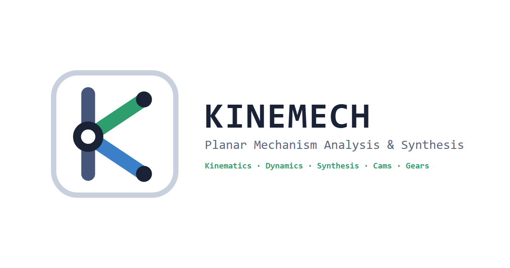
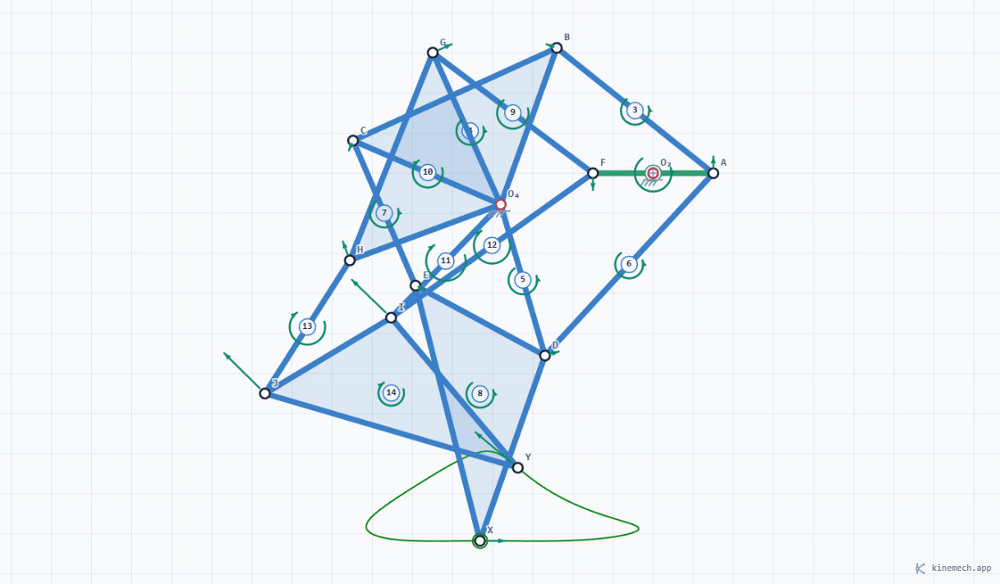

# KineMech

KineMech is a free, open-source tool for planar mechanisms. It runs in your
browser. You can draw a linkage, calculate its motion and forces, simulate it
under applied loads, synthesize a mechanism, or design cams and gears.

Use it at **[kinemech.app](https://kinemech.app/)**. No installation or account
is needed. The current version is **5.0.0**.

The app has four tools:

| Tool | What it does |
| --- | --- |
| **Analyzer** | Calculates position, velocity, acceleration and joint forces, and simulates motion under applied torque or force. |
| **Synthesizer** | Finds four-bar, offset slider-crank and six-bar mechanisms for prescribed motion, paths, functions, quick return and dwell. |
| **Profiler** | Designs plate, cylindrical and linear cams from follower motion programs, and models the follower's elastic response. |
| **Gears** | Designs involute gear pairs and solves fixed-axis and planetary gear trains. |

Designs pass directly between the tools. A synthesized linkage opens in the
Analyzer. A traced joint path goes to the Synthesizer. The Profiler supplies
cam profiles, and Gears supplies tooth designs for fixed-center meshes.

## Analysis

Draw a mechanism from pin joints, sliders, gears, rotating slots and
cam-follower pairs. Links can join two, three or more joints, and a mechanism
can have several loops. The solver checks degrees of freedom before solving
and reports input limits and singular positions.

Position, velocity and acceleration are calculated from the mechanism's
constraint equations. You can inspect the vectors, draw velocity and
acceleration polygons, and plot results over a crank revolution. A plain
pin-jointed four-bar also gets a Grashof classification and minimum and
maximum transmission angles.

The instant center of every pair of bodies is listed and drawn, and
constructed step by step by Kennedy's rule beside its linear graph. The same
tab gives the velocity of slip at each sliding and cam contact, the velocity
ratio and mechanical advantage between the input and an output point, the
fixed and moving centrodes of a pair, and the jerk of every joint and link.

### Forces and balancing

Enter mass, moment of inertia and center of gravity for each moving link.
With the motion prescribed, kinetostatic analysis calculates the joint
reactions and input torque or force needed to produce it. Gravity, point
forces, applied torques, linear and torsional springs, dampers and flywheels
can be included. Contacts are frictionless.

The results include an exploded free-body diagram, force and torque plots,
shaking force and peak reactions. For conjugate cams, the analysis shows
which cam carries the load and where the load transfers between them.

The Balancing tab places counterweights on any moving links to minimize the
shaking force, or checks counterweights you place yourself, and compares the
shaking force, shaking moment, input torque and bearing loads before and
after. A plain four-bar gets the classical loop-closure balance and a
slider-crank its primary and secondary forces. You can trade shaking force
against shaking moment, and split the crank's counterweight between two
planes so that it adds no rocking couple.

### Forward dynamics

To calculate motion under applied loads, choose **Apply torque/force** on
the Drive step. The input effort can be zero, constant, a DC motor law, a
speed controller, a harmonic (a mean plus a sinusoid), or a table over time
or input angle. Point loads and couples can follow their own tables, such as
a gas force on a piston.

Press **Simulate** to calculate a run. The results include:

- Playback and a slider for inspecting the mechanism at any retained time.
- Plots of motion, input effort, reactions and element forces against time.
- Kinetic and potential energy, input work, damper losses and energy balance.
- CSV export of the run and a GIF with frames evenly spaced in time.

The simulation maintains loop closure by solving the mechanism's position
during integration. It stops at a follower jump, change point or input limit
and reports the event. An optional continuation follows another turning link
through an input limit.

A flywheel can be sized from the constant-speed force cycle for a chosen
speed fluctuation, then checked in a simulation. Energy balance provides a
check on the run; convergence should be checked with a smaller step or
tighter tolerance.

The **Vibration** results tab linearizes the mechanism about its rest
position, for small motions. It reports the natural frequency, damping
ratio and damped period, and the steady response to a harmonic effort.
**Release and simulate** checks the linear period against a simulated run.

Set the drawing's length unit to m, cm, mm, in or ft. Mass is in kg, inertia
in kg·m², force in N, torque in N·m and linear spring stiffness in N/m. If no
length unit is set, force analysis assumes one drawing unit is one metre.

## Synthesis

The Synthesizer finds a mechanism from the motion you need. Results can be
animated, exported as a GIF and opened in the Analyzer. Grashof condition,
transmission angle, and circuit, branch and order defects are checked where
applicable.

**Motion generation.** Specify two, three or four coupler postures using a
point and an angle or two points. Moving pivots can be changed to obtain
another linkage for the same motion. Two-position synthesis allows ground
pivots on perpendicular bisectors, prescribed link rotations and a rocker
output. Three-position synthesis also accepts fixed ground pivots or
prescribed crank and rocker rotations. A driver dyad can turn a rocking
input into a six-bar driven by a full-turn crank.

**Path generation.** Specify three or four precision points, with optional
coupler orientations and crank angles. **Solve free choices** searches the
available geometry for a suitable linkage. To fit a whole curve, import a
`.kinepath` file or `x,y[,theta]` CSV, send a traced path from the Analyzer,
or draw an editable spline on the canvas. **Match** fits a four-bar and
reports RMS and maximum path error, with the largest miss marked. The
searches are deterministic.

**Function generation.** Specify three, four or five precision points, with
optional Chebyshev spacing. The solver uses Freudenstein's equation, ranks
multiple solutions and reports structural error over the domain.

**Quick return.** Design an offset slider-crank, four-bar crank-rocker,
drag-link six-bar or Whitworth six-bar for a required time ratio. The achieved
ratio, stroke and swing are measured over a crank revolution and compared
with the inputs.

**Dwell.** Find a Stephenson III six-bar with one or two approximate holds
per revolution. The result reports the achieved hold windows and output
swing.

Four-bar motion, path and function results can show the two Roberts–Chebyshev
cognates that trace the same coupler curve. Motion and path generation can
also show construction geometry, coordinates and angles.

## Cam design

Build a follower motion program from rise, dwell and fall segments. Each
segment can use uniform, parabolic, simple harmonic, cycloidal, modified
trapezoid, modified sine, or 3-4-5 and 4-5-6-7 polynomial motion. The program
is checked against the fundamental law of cam design.

The Profiler supports plate, cylindrical and linear cams. Plate followers
can be knife-edge, roller, flat-faced or spherical-faced, mounted in-line,
offset or pivoted. Results include displacement, velocity, acceleration and
jerk charts, graphical construction, pressure angle and undercut checks.
Flat-faced followers are checked for concavity that they cannot follow.

A cam profile can be sent to the Analyzer for contact-force analysis and
simulation. Cams and gears can share shafts, and one cam can drive several
followers. Followers of different types can ride the same profile, with
their motion calculated from contact. A conjugate cam can hold a follower
from the other side without a return spring.

The Analyzer can also send a joint's or link's motion to the Profiler as a
program. Imported programs are fitted with a Fourier series before profile
generation. While a cam is redesigned, its other followers and conjugate cam
are shown as references. Profile CSV includes the conjugate profile when
present.

### Follower dynamics

To model the follower's vibration, tick **Model the follower's elasticity**
in the Profiler. The follower becomes a mass on an elastic follower train,
held to the cam by a preloaded return spring, with damping.

The **Follower dynamics** tab shows each result beside the rigid follower's:

- Peak acceleration, contact force and the preload needed to keep contact.
- The vibration left after each rise and fall, and where it settles.
- Where the follower leaves the cam, and the speed at which it first jumps.

The **Follower** charts compare the commanded and actual motion and the
contact force. The **Spectrum** chart compares the motion laws by the
vibration one move leaves. Problem 10 is a worked example.

## Gear design

Gears supports external, internal and rack involute meshes. Choose 20°, 25°
or 14.5° full-depth teeth, 20° stub teeth, or a custom pressure angle.
Profile shift is available for external gears and pinions against a rack.

External tooth roots and undercut are generated from a rolling rack cutter.
Internal gears use analytic flanks and schematic roots. Results include
operating pressure angle, center distance, clearance, top land, contact
ratio, interference and the minimum shift to remove undercut. **Run the
pair** checks sampled tooth outlines for overlap over one tooth pitch.
Designs export as CSV and SVG.

Simple, compound, planetary and custom trains use a Willis-equation solver,
with a table for each carrier. The solver reports missing, redundant or
contradictory speed specifications. Planetary checks include fit, neighbor
clearance and, for simple sets, assembly. Ideal member and frame torques can
be calculated from one specified torque when the static problem is
determinate.

Use **Open in Gears** on an Analyzer mesh to design its teeth. **Use in
Analyzer** returns the tooth counts and pressure angle at the existing
centers. Profile shift is not reproduced in the Analyzer's tooth drawing.
Planetary trains remain in Gears because Analyzer meshes have fixed centers.

## Getting started

Choose a tool from the empty workspace or load one of the seventeen example
mechanisms. Examples cover linkages, sliders and quick return, gears, cams,
and forces and motion. They include a Jansen walking linkage, a radial
engine, a falling four-bar and an engine with a gas force and flywheel.

The Analyzer has five steps:

1. **Topology:** place joints, connect links or spring-damper elements, and
   choose the ground joints.
2. **Geometry:** set dimensions and length units. To trace an image,
   calibrate it using two points and a known distance. Gear and cam cards
   open their design tools.
3. **Elements:** enter mass, inertia and center of gravity for every moving
   link before force analysis or simulation. Set spring, damper and flywheel
   properties here.
4. **Drive:** choose the input link or slider. Prescribe its motion or apply
   a torque or force. Add gravity, point loads and couples as needed.
5. **Solve:** animate and inspect motion, polygons, free-body diagrams,
   forces and plots. In effort mode, press **Simulate** to calculate a run.

## Saving and export

| Format | Contents |
| --- | --- |
| `.kinemech` | Mechanism geometry, roles, drive and simulation settings, dimensions, units, calibration and an embedded background image. |
| `.kinepath` | Path points, optional crank angles and closure information. Drawn paths retain their editable spline points. |
| `.kinemotion` | Follower displacement and derivatives against cam angle, with closure and translation or rotation information. A Profiler export also carries the cam design and its follower dynamics settings. |
| `.kinegears` | Gear pairs or trains, tooth systems, profile shifts and known speeds. |

Older mechanism and gear documents remain readable. A saved simulation
contains its settings; the run is recomputed when needed. Path and motion
programs can also be imported as CSV.

Each tool autosaves separately in the browser. After a crash or refresh,
the last snapshot is offered as a download. A second tab of the same tool
is locked to prevent competing writes. If the browser blocks storage, the
app reports that autosave is unavailable; save to a file before closing.

Plots and simulation runs export as CSV. The Profiler exports profile
coordinates and, with the follower modeled, its response and the vibration
spectrum. Gears exports geometry as CSV and SVG. The Analyzer,
Synthesizer and Profiler also export animated GIFs. Analyzer GIFs can include
the velocity and acceleration polygon panel.

## Feedback

To report a problem or request a feature, choose **Send feedback** in any
tool's "···" menu. The dialog shows everything it will send before you press
**Send**: your description, an optional email for a reply, the tool and
version, and your browser and screen size. You can attach the design you
have open; a traced reference image is always left out. If a tool crashes,
its error screen offers **Report this crash**.

## License

KineMech is released under the [MIT License](LICENSE).

## Citation

If you use KineMech in research or teaching material, please cite its Zenodo
DOI: [10.5281/zenodo.21843046](https://doi.org/10.5281/zenodo.21843046).
[CITATION.cff](CITATION.cff) contains the citation details for version 5.0.0.
